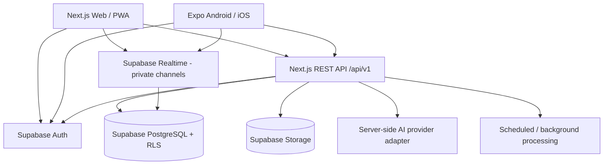

# Architecture — KINNIPAW

## 1. Style

Modular monolith, API-first for shared Web/Mobile business operations, single relational database, managed authentication/storage/realtime. Avoid premature microservices.

## 2. Logical topology



## 3. Request flow

1. Validate request shape with a shared Zod contract.
2. Verify the Supabase session/access token.
3. Build a request-scoped server Supabase client using the user's token so database RLS applies.
4. Check role, resource ownership, organization membership, block state and resource status.
5. Execute business operation through a domain service and database transaction where needed.
6. Return a sanitized response using explicit response schemas.
7. Emit notifications/events without exposing private payloads.
8. Log request ID and security-relevant audit events; never log secrets or message bodies unnecessarily.

## 4. Client responsibilities

### Web
- Next.js App Router.
- Server Components by default.
- Client Components only for interaction.
- SSR sessions using supported Supabase SSR integration and secure cookies.
- Versioned REST API for shared mutations.

### Mobile
- Expo Router.
- Supabase Auth with secure device storage; do not use browser localStorage semantics.
- Shared API client and contracts.
- Native camera/photo picker and push registration with explicit permission requests.
- Offline behaviour limited to safe cached/read-only screens unless conflict handling is designed.

## 5. Domain modules

Identity, Organizations, Animals, Social, Adoption, LostFound, Rescue, Messaging, Notifications, Care, Providers, Events, Moderation, AI and Operations. Each module owns its validation, service functions, repository/data access, tests and relevant API handlers.

## 6. Data-access policy

- Never use a service-role key for ordinary end-user requests.
- RLS is defence in depth, not a substitute for clear business authorization.
- Use transactions for adoption decisions, assignment and other race-sensitive transitions.
- Do not allow client-supplied owner IDs, role IDs or moderation actors to establish authority.

## 7. Background work

Use scheduled/triggered work for reminders, notification fan-out, cleanup and AI tasks only after choosing an implementation compatible with the free-tier/hosting constraints. Jobs must be idempotent, retryable and observable. Do not assume a long-running process is available on serverless hosting.

## 8. Monorepo layout

```text
apps/web/src/app/          # pages and route handlers
apps/web/src/features/     # server services and feature UI
apps/mobile/app/           # Expo routes
apps/mobile/src/features/  # native feature UI
packages/contracts/        # Zod requests/responses
packages/api-client/       # typed client
packages/database-types/   # generated DB types
packages/design-tokens/    # brand-neutral tokens
supabase/migrations/       # versioned SQL
supabase/tests/            # RLS/integrity tests
docs/                      # canonical specs
```

## 9. Architecture decisions

See `DECISIONS.md`. Any stack, database, auth, API, tenancy or hosting change needs an explicit decision record and impact review.
