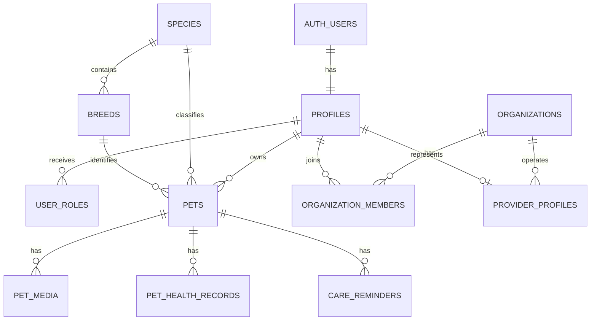
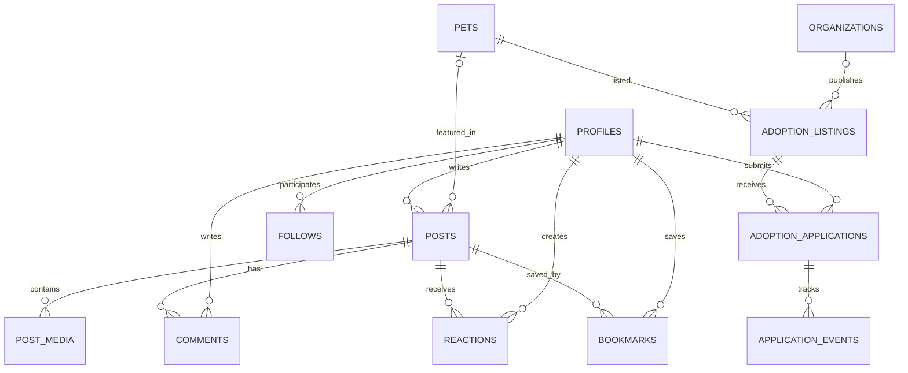
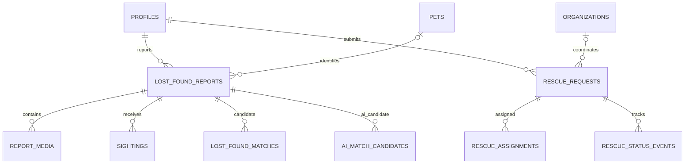
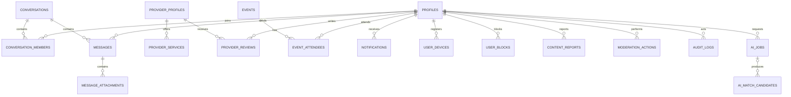

# Logical ERD — KINNIPAW

The diagrams show major relationships. The authoritative table inventory is `SCHEMA_SPEC.md`. Supabase `auth.users` is managed externally and is not a KINNIPAW-owned table.

## Identity, animals and organizations

## Social and adoption

## Lost-and-found and rescue

## Messaging, providers, events and platform safety

## Relationship notes

- Follows, reactions, bookmarks, organization memberships, conversation memberships and event attendees are many-to-many relationships represented by junction tables.
- Provider ownership is either an individual user or an organization; enforce the chosen exclusive-owner rule.
- A lost/found report may reference a known pet or an unknown animal.
- `content_reports` and `moderation_actions` use polymorphic targets in the baseline and need an explicit integrity strategy.
- The two match tables are retained pending a reviewed decision.
