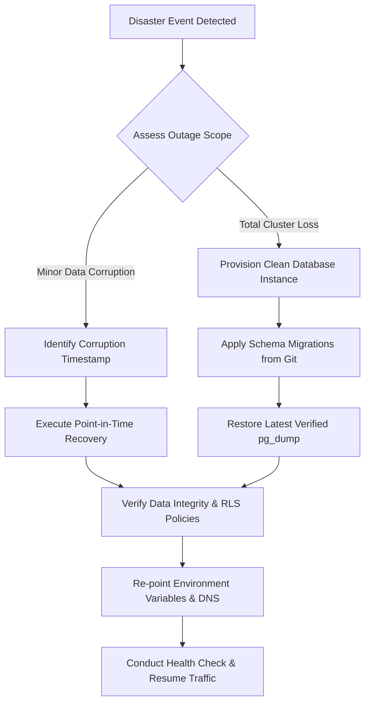

# Backup and Disaster Recovery Strategy — KINNIPAW

> Status: STUB | Last updated: 2026-11-08 | M0 Documentation Reconciliation
> 
> Note: Stub — requires D-7 (Supabase tier) and D-8 (hosting) resolution before completion.

This document outlines the backup procedures, disaster recovery protocols, recovery objectives, and restore testing schedule for KINNIPAW. A backup strategy is only as valid as its most recent verified restore test.

---

## 1. Objectives and Targets

| Metric | Target (Production / Post-D-7) | Free-Tier Reality (Current M0) | Definition |
|---|---|---|---|
| **Recovery Point Objective (RPO)** | `< 1 hour` (via Point-in-Time Recovery) | Up to `24 hours` (Daily logical dump) | Maximum acceptable duration of transactional data loss during a disaster event. |
| **Recovery Time Objective (RTO)** | `< 2 hours` | `< 6 hours` | Maximum acceptable duration required to restore full service after failure. |

---

## 2. Database Backup Strategy

### 2.1 Supabase Tier Differences (Dependent on D-7)

- **Supabase Free Tier:**
  - Automated daily backups are maintained for 7 days, but individual self-service point-in-time restores are not included.
  - Project automatically pauses after 1 week of inactivity.
  - **Mitigation:** Implement automated daily external logical backups (`pg_dump`) triggered via scheduled GitHub Actions or external cron jobs into encrypted S3-compatible cold storage (e.g. Cloudflare R2 / AWS S3).
- **Supabase Pro Tier ($25/mo):**
  - Daily automatic backups retained for 7 days with 1-click restore.
  - Optional Point-in-Time Recovery (PITR) add-on allowing granular recovery down to the exact second.
  - No project pausing; production SLA guarantee.

### 2.2 Git-Backed Schema as Source of Truth
- All database definitions, tables, functions, RLS policies, and triggers are stored as version-controlled SQL migrations in `supabase/migrations/`.
- In a total database cluster failure, a clean database instance can be reconstituted from scratch in minutes by executing:
  ```bash
  supabase db reset --db-url "$NEW_DATABASE_URL"
  ```
- Application state and transactional history are then restored from the latest verified logical backup.

---

## 3. Media and Storage Backup Strategy

- **Uploaded Media Assets:** Pet photos, user avatars, verification documents, and medical timeline records are stored in Supabase Storage buckets:
  - `public-media`: Public animal photos, avatars, and post images.
  - `private-documents`: Sensitive KYC identification, veterinary licenses, and medical records.
- **Bucket Replication & Synchronization:**
  - Scheduled daily incremental rsync / rclone job synchronizing Supabase Storage buckets to an independent, geographically separated S3-compatible bucket (e.g. Backblaze B2 / Cloudflare R2).
  - Preserves metadata, folder hierarchies, and object ACLs.
- **Image Sanitization:** Stripped EXIF/GPS metadata guarantees that even in the event of an accidental storage misconfiguration, raw private coordinates are not present in image binaries.

---

## 4. Disaster Recovery and Restore Procedure

In the event of database corruption, accidental deletion, or cloud region failure:



### Step-by-Step Restoration Drill:
1. **Declare Incident:** Freeze incoming mutations by activating platform maintenance mode via Next.js middleware.
2. **Provision Target Database:** Spin up a new target database instance on Supabase or self-hosted PostgreSQL.
3. **Replay Migrations:** Apply all tracked migrations from the repository to establish constraints and schema shape.
4. **Restore Data:** Import decrypted database dump:
   ```bash
   psql "$RESTORE_DATABASE_URL" < latest_sanitized_dump.sql
   ```
5. **Verify Row Level Security & Triggers:** Run the automated pgTAP test suite against the restored database to confirm all RLS policies are active and functioning.
6. **Re-attach Storage:** Validate storage bucket links and test signed URL generation for private documents.
7. **Switch Traffic:** Update `DATABASE_URL` and `SUPABASE_URL` connection strings in hosting environment secrets and deactivate maintenance mode.

---

## 5. Verification Drills and Testing Schedule

- **Automated Validation:** Every database backup script must verify exit status codes and check non-zero dump file size before logging success.
- **Quarterly Disaster Drills (PB-118):**
  - Conduct a staged disaster simulation every quarter during beta and production phases.
  - Restore backup to a staging environment and run the full Playwright E2E suite against restored data.
  - Document restore duration, issues encountered, and update RTO/RPO metrics accordingly.
