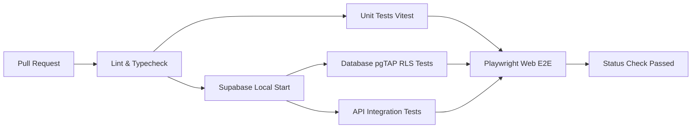

# Test Strategy — KINNIPAW

> Status: STUB | Last updated: 2026-11-08 | M0 Documentation Reconciliation
> 
> Note: Stub — requires owner review and sign-off before M1 begins.

This document defines the comprehensive testing strategy for the KINNIPAW platform across web, mobile, API, and database layers. In accordance with the project guidelines, no feature is considered complete without automated tests verifying functional behavior, authorization boundaries, error states, and regression resistance.

---

## 1. Testing Philosophy and Principles

1. **Shift-Left Testing:** Validation rules, business logic, and security authorization are tested at the earliest possible stage (schemas, unit tests, and local database migrations).
2. **Authorization-First:** Every exposed database table and API route must be verified against positive and negative authorization cases (unauthenticated, unauthorized user, resource owner, applicant, moderator, admin).
3. **Reproducible Test Environments:** All database and integration tests execute against a deterministic local Supabase instance running in Docker via the Supabase CLI.
4. **Pyramid Approach:** Broad unit tests at the base, focused API and component integration tests in the middle, and lightweight critical-path E2E tests at the top.

---

## 2. Testing Layers and Frameworks

| Layer | Tool / Framework | Scope & Responsibility | Target Execution |
|---|---|---|---|
| **Unit Testing** | Vitest | Zod schemas, contract serialization, date/location utilities, business calculation rules | In-memory, watch mode, pre-commit |
| **Component Testing** | React Testing Library + Vitest | Web UI component rendering, accessible labels, interactive states, loading/error UI | In-memory DOM (jsdom / happy-dom) |
| **API & Route Handlers** | Vitest + Supabase Local | Next.js `/api/v1` route handlers, server action functions, transaction integrity | Local Docker Supabase instance |
| **Authorization & RLS** | pgTAP + Vitest | Row Level Security (RLS) policies on all 43 tables, role permissions, ownership validation | Local PostgreSQL via pgTAP / custom runner |
| **Database Integrity** | pgTAP | Table schemas, constraints, foreign key cascades, triggers, indexing, custom SQL functions | Local PostgreSQL in Docker |
| **E2E Web** | Playwright | Full end-to-end browser journeys across desktop and mobile viewports | Headless Chromium, Firefox, WebKit |
| **E2E Mobile** | Maestro | React Native / Expo native workflows on iOS and Android simulators | Simulator / Emulator builds in CI |

---

## 3. Layer Specifications

### 3.1 Unit Testing (Vitest)
- Targets shared logic in `packages/contracts`, `packages/utils`, and internal service modules.
- Validates Zod schema parsing, edge cases, string sanitization (HTML stripping), and coordinate fuzzing algorithms.
- Pure execution with zero external network or database dependencies.

### 3.2 Component Testing (React Testing Library)
- Tests web components in `apps/web/components`.
- Verifies responsive state variants: loading skeletons, empty states, error banners with retry triggers, and success messages.
- Verifies accessibility: ARIA attributes, keyboard focusability, accessible error announcements.
- Mocks API calls via MSW (Mock Service Worker) or typed client mock fixtures.

### 3.3 API and Integration Testing (Vitest + Local Supabase)
- Exercises Next.js App Router route handlers (`/api/v1/*`).
- Validates request payload validation, HTTP status codes, standard response envelope shapes (`success`, `data`, `error`, `meta`).
- Validates database transaction rollback behavior on failed multi-step mutations (e.g. creating adoption listings with media records).

### 3.4 Authorization and Row Level Security (RLS) Testing
- **Mandatory Requirement:** Every single exposed table in the canonical 43-table schema must have dedicated RLS tests.
- Tests simulate 6 distinct security personas:
  1. `anon` (unauthenticated guest)
  2. `auth_user_a` (authenticated general user / resource owner)
  3. `auth_user_b` (authenticated unrelated user / non-owner)
  4. `applicant` (user with specific contextual permission, e.g. active adoption applicant)
  5. `moderator` (user with platform moderation role)
  6. `admin` / `super_admin` (administrative role)
- Verifies that private tables (`user_health_records`, `conversations`, `messages`, `kyc_documents`) cannot be accessed by unauthorized identities even if IDs are known.

### 3.5 Database Integrity Testing (pgTAP)
- Written in standard pgTAP format (`.sql` files).
- Asserts presence of required check constraints, foreign keys, unique indexes, and PostGIS geometry columns.
- Validates audit logging triggers and updated_at automatic timestamp triggers.

### 3.6 End-to-End Web Testing (Playwright)
- Automates critical user journeys:
  - Account signup, email confirmation simulation, profile creation.
  - Pet profile creation, media upload, privacy setting adjustment.
  - Adoption listing publication, application submission, owner review, status transition to adopted.
  - Lost pet report submission, sighting creation, rule-based candidate review, reunion confirmation.
  - Rescue request dispatch, triage, assignment, status update, closure.
  - Moderation queue review, content report handling, warning/suspension application.
- Tests responsive viewports: 360px (mobile), 768px (tablet), 1280px (desktop).

### 3.7 End-to-End Mobile Testing (Maestro)
- Declarative YAML flows executed against Expo native debug builds.
- Validates mobile navigation tabs, photo picker interactions, offline notification alerts, and deep links.

---

## 4. Coverage Targets by Layer

| Layer | Minimum Required Line Coverage | Critical Path Target |
|---|---|---|
| Shared Contracts & Zod Schemas (`packages/contracts`) | 95% | 100% |
| API Route Handlers & Data Access Layer (`apps/web/app/api`) | 90% | 100% |
| Database RLS Policies (all exposed tables) | 100% of tables tested | 100% |
| Web UI Logic & Custom Hooks (`apps/web`) | 80% | 90% |
| Mobile Components & Hooks (`apps/mobile`) | 75% | 85% |
| End-to-End Core User Journeys | N/A (Flow-based) | 100% of P0 journeys |

---

## 5. Test File Naming and Organization Conventions

```
apps/web/
  ├── components/
  │   └── [Component].tsx
  │   └── [Component].test.tsx           # Component test adjacent to source
  ├── app/api/v1/[route]/
  │   └── route.ts
  │   └── route.test.ts                  # Route integration test
packages/
  ├── contracts/
  │   └── src/**/*.test.ts               # Unit tests for contracts/schemas
tests/
  ├── e2e/
  │   ├── web/
  │   │   ├── auth.spec.ts               # Playwright E2E web specs
  │   │   ├── adoption.spec.ts
  │   │   ├── lost-found.spec.ts
  │   │   └── rescue.spec.ts
  │   └── mobile/
  │       └── .maestro/
  │           ├── auth_flow.yaml         # Maestro mobile E2E flows
  │           └── pet_creation.yaml
supabase/
  └── tests/
      ├── 01_rls_animals.sql             # pgTAP database authorization tests
      ├── 02_rls_adoptions.sql
      ├── 03_rls_messaging.sql
      └── 04_schema_integrity.sql
```

---

## 6. Seed Data Strategy

- **Local Development & Testing Seed:** Stored in `supabase/seed.sql`. Contains deterministic, non-sensitive fixtures:
  - Fixed test accounts with known credentials (`test-owner@kinnipaw.local`, `test-rescuer@kinnipaw.local`, `test-mod@kinnipaw.local`).
  - Standard reference taxonomies (species, breeds, administrative divisions of Bangladesh, emergency severity codes).
  - Mock animal profiles representing dogs, cats, birds, and small mammals with sanitized sample images.
- **Dynamic Test Factories:** Implemented in `tests/factories/` using `@faker-js/faker` wrapped in typed Zod builders. Allows tests to generate valid randomized test payloads with override capabilities.
- **Strict Data Sanitization:** Under no circumstances are production customer records, live coordinates, or private contact details imported into test databases.

---

## 7. CI Pipeline Integration (GitHub Actions)

Every pull request executes an automated test matrix before merge eligibility:



- **PR Gate:** Lint, strict TypeScript check, Vitest unit & component tests, Supabase DB migrations, pgTAP RLS tests.
- **Nightly / Staging Gate:** Full matrix Playwright web tests across all browsers and responsive viewports; Maestro mobile regression suite.
- **Merge Blockers:** Any failed authorization test, dropped test coverage below threshold, or schema migration failure strictly blocks PR merge.
